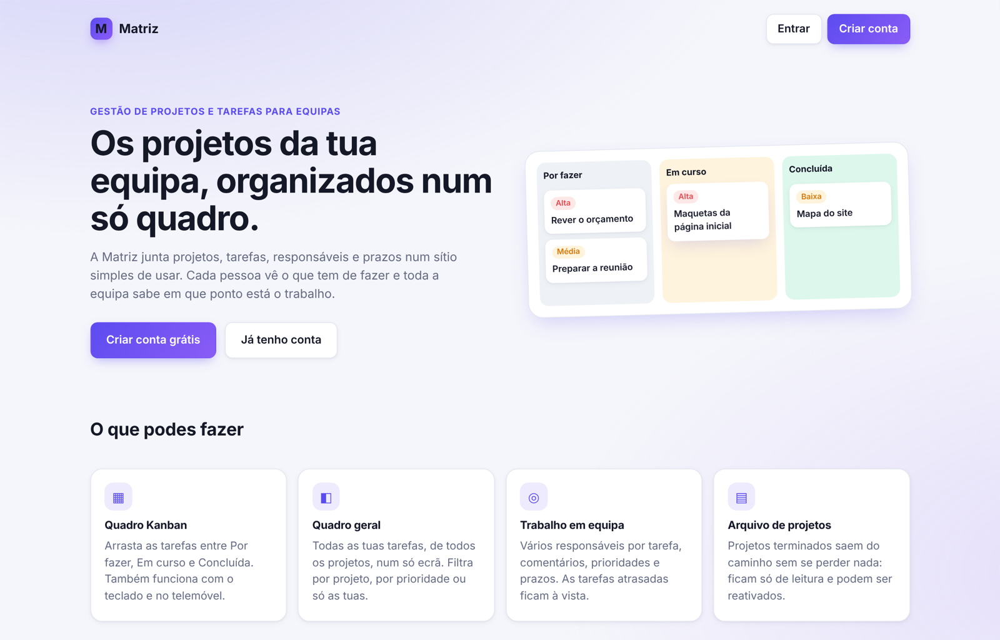
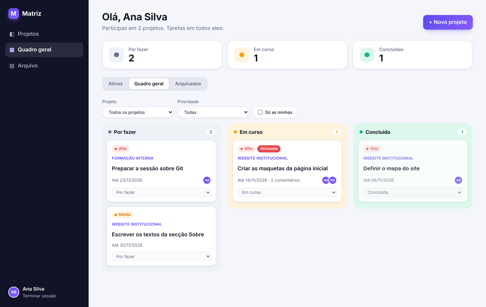
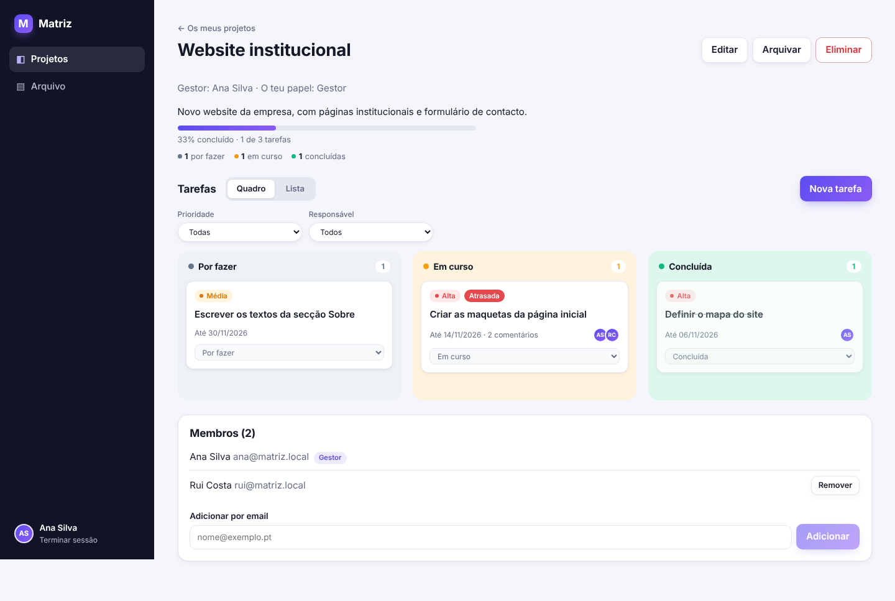
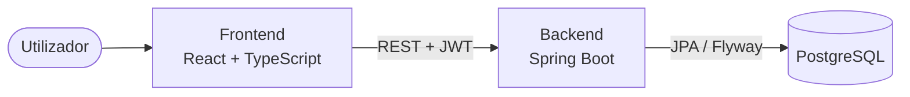
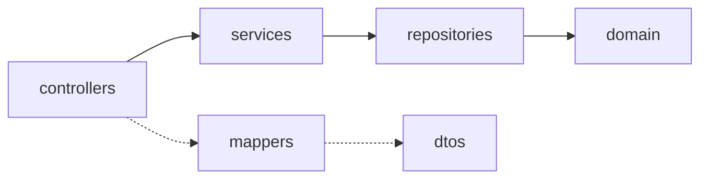

# Matriz

**Gestão de projetos e tarefas para equipas: quadro Kanban, responsáveis, prazos e comentários, numa aplicação full-stack em Java + Spring Boot e React.**

[](https://github.com/mariohenriquep/matriz-api/actions/workflows/ci.yml)
[](https://sonarcloud.io/summary/new_code?id=mariohenriquep_matriz-api)


🔗 **Experimentar online:** [matriz-frontend-650f.onrender.com](https://matriz-frontend-650f.onrender.com)
 · API: [matriz-backend-q9kv.onrender.com](https://matriz-backend-q9kv.onrender.com/actuator/health)

> Alojada no plano gratuito do Render: se ninguém a usou nos últimos minutos, o primeiro acesso pode demorar cerca de um minuto enquanto o servidor acorda.



<details>
<summary><b>🇬🇧 English summary</b></summary>

Matriz is a full-stack project and task management app for teams, built from scratch as the course project of *AI-Powered Software Engineering*. Teams organise work into projects, assign tasks to several people, track deadlines and progress on a drag-and-drop Kanban board, and discuss each task in comments. Every user only sees the projects they belong to, and that rule is enforced by the API, not just the UI.

- **Backend:** Java 21, Spring Boot 3.5 (Web, Security with JWT, Data JPA), PostgreSQL 16 with Flyway, clean architecture enforced by ArchUnit.
- **Frontend:** React 19, TypeScript, Vite.
- **Quality:** ~190 automated tests (JUnit 5 + Testcontainers, Vitest + Testing Library, Playwright E2E), contract checks against the OpenAPI 3.1 spec, code and security review.
- **Delivery:** Docker multi-stage images, Docker Compose, GitHub Actions CI with Trivy, Gitleaks and SonarQube Cloud, images published to Docker Hub, deployed on Render.
- **AI-assisted, human-in-the-loop:** specification, architecture, implementation and reviews were done with an AI coding agent under explicit project rules ([`AGENTS.md`](AGENTS.md)); every step is logged in [`docs/ai-log/`](docs/ai-log/).

The code, UI and documentation are in Portuguese (Portugal).
</details>

## O que é

As equipas precisam de um sítio único onde organizar projetos, distribuir tarefas e saber em que ponto está o trabalho. Sem isso, as tarefas perdem-se em emails e conversas, não é claro quem faz o quê e é difícil perceber quanto falta.

A Matriz resolve isto com projetos, membros e tarefas num quadro Kanban. Foi construída de raiz, da especificação ao deploy, no âmbito da unidade curricular *AI-Powered Software Engineering*, com um agente de IA como par de programação e todas as decisões validadas por mim.

## Funcionalidades

- **Quadro Kanban** por projeto: arrastar as tarefas entre `Por fazer`, `Em curso` e `Concluída`, também com teclado e no telemóvel.
- **Quadro geral:** as tarefas de todos os projetos num só ecrã, com filtros por projeto, prioridade e "Só as minhas".
- **Tarefas completas:** prioridade, data limite (as atrasadas ficam assinaladas), vários responsáveis e comentários com autor e data.
- **Projetos e equipas:** quem cria um projeto fica Gestor e adiciona membros pelo email; pesquisa pelo nome, filtros guardados no endereço da página e progresso sempre atualizado.
- **Arquivo de projetos:** um projeto terminado fica só de leitura e pode ser reativado.
- **Contas e segurança:** registo público com plano gratuito, login com JWT, bloqueio após 5 tentativas falhadas, limites de pedidos por IP e regras de password. Cada utilizador só vê e altera os projetos de que é membro, também em pedidos diretos à API.
- **Modo escuro e layout responsivo.**

| Quadro geral | Projeto com quadro Kanban |
|:---:|:---:|
|  |  |

## Tecnologias

| Área | Tecnologia |
|------|-----------|
| Backend | Java 21, Spring Boot 3.5 (Web, Security com JWT, Data JPA, Validation, Actuator), Flyway, Maven |
| Base de dados | PostgreSQL 16 (5 migrações Flyway) |
| Frontend | React 19, React Router, TypeScript, Vite |
| API | REST com contrato [OpenAPI 3.1](openapi.yaml) (24 operações) e erros em Problem Details (RFC 9457) |
| Testes | JUnit 5, Testcontainers, ArchUnit; Vitest e Testing Library; Playwright (E2E) |
| Entrega | Docker (imagens multi-stage, sem privilégios), Docker Compose, GitHub Actions, Trivy, Gitleaks, SonarQube Cloud, Docker Hub, Render |

## Arquitetura

Um monólito modular com uma SPA e uma API REST. Simples de alojar, de testar e de evoluir para uma equipa pequena; a justificação e as alternativas estão em [`docs/architecture.md`](docs/architecture.md).



O backend segue uma **clean architecture**: as dependências só apontam para dentro, e o teste `ArquiteturaTest` (ArchUnit) falha o build se alguém quebrar esta regra.



| Pacote | O que contém |
|--------|--------------|
| `domain` | Entidades e regras do negócio, sem dependências das outras camadas. |
| `repositories` | Acesso à base de dados. |
| `services` | Casos de uso: validações, regras de acesso e transações. |
| `controllers` | Endpoints REST; só tratam de HTTP. |
| `dtos`, `mappers` | Pedidos e respostas da API (iguais ao `openapi.yaml`) e a conversão para o domínio. |
| `security`, `exceptions`, `config` | Autenticação JWT, erros em Problem Details, configuração. |

## Qualidade e testes

Cerca de **190 testes automáticos** correm em cada pull request:

- **Backend (~130):** testes unitários, de integração contra um PostgreSQL real em Testcontainers e de arquitetura.
- **Frontend (~60):** componentes e cliente da API com Vitest e Testing Library.
- **E2E:** 4 cenários com Playwright (criar tarefa, Kanban e arquivo, quadro geral, registo).
- **Contrato:** [`scripts/verificar-contrato.py`](scripts/verificar-contrato.py) percorre todas as operações do `openapi.yaml` contra a API a correr.

A pipeline de [CI](.github/workflows/ci.yml) corre os testes, analisa dependências, configuração e imagens com o **Trivy**, procura segredos em todo o histórico do Git com o **Gitleaks**, envia a cobertura para o **SonarQube Cloud** e só depois constrói e arranca as imagens Docker. Numa tag de versão publica as imagens no Docker Hub ([`marrike/matriz-backend`](https://hub.docker.com/r/marrike/matriz-backend), [`marrike/matriz-frontend`](https://hub.docker.com/r/marrike/matriz-frontend)).

Também houve uma [Code Review e Security Review](docs/quality-security-review.md) com findings classificados por severidade e as correções aplicadas (por exemplo, o bloqueio do login), e testes de IDOR com contas de demonstração: nenhum utilizador consegue ler ou alterar projetos de que não é membro.

## Executar localmente

Só com o Docker:

```bash
git clone https://github.com/mariohenriquep/matriz-api.git && cd matriz-api
cp .env.example .env            # editar POSTGRES_PASSWORD e MATRIZ_JWT_SEGREDO (openssl rand -base64 48)
docker compose up -d --build    # PostgreSQL, backend e frontend
```

Abre http://localhost:8000. Com o `.env.example` tal como está (`MATRIZ_SEED_ATIVO=true`), o primeiro arranque cria três contas de demonstração e três projetos (contas em [`docs/como-executar.md`](docs/como-executar.md#4-dados-de-demonstração)).

Para desenvolver (Java 21 e Node 22):

```bash
docker compose up -d postgres                   # só a base de dados
cd backend && ./mvnw spring-boot:run            # API em http://localhost:8080/api/v1
cd frontend && npm install && npm run dev       # http://localhost:5173
```

Testes: `cd backend && ./mvnw test` (precisa do Docker), `cd frontend && npm test`, `cd e2e && npm test`.

O guia completo, com as contas de demonstração, a autenticação, os problemas comuns, a CI e o deploy no Render, está em [**`docs/como-executar.md`**](docs/como-executar.md).

## Desenvolvimento com IA

A Matriz foi feita com um agente de IA (Claude Code) como par de programação, num processo *human-in-the-loop*: a IA propõe, eu decido.

- **Especificação primeiro.** Antes de qualquer código: requisitos, user stories com critérios de aceitação, restrições, arquitetura, modelo de dados, contrato OpenAPI e wireframe. A IA trabalha a partir destes documentos, não de pedidos soltos.
- **Regras para o agente.** O [`AGENTS.md`](AGENTS.md) diz o que ler antes de agir, proíbe inventar funcionalidades, obriga a planear mudanças grandes e a pedir aprovação antes de ações destrutivas, e protege segredos.
- **Rasto de cada passo.** Em [`docs/ai-log/`](docs/ai-log/) há 34 registos, um por exercício: o prompt, o que a IA produziu, o que eu revi, corrigi ou recusei.
- **Verificação.** Nada entra sem testes, revisão e CI verde; as revisões de código e de segurança foram feitas com a IA e confirmadas com evidência.

## Percurso

| Fase | O que foi feito |
|------|-----------------|
| 1. Especificação | [Requisitos](docs/requirements.md), [user stories](docs/user-stories.md), [restrições](docs/constraints.md) |
| 2. Conceção | [Arquitetura](docs/architecture.md), [modelo de dados](docs/database.md), [OpenAPI](openapi.yaml), [wireframe](docs/ui/) |
| 3. Desenvolvimento | MVP full-stack em clean architecture, [verificado em 9 cenários](docs/verification.md) |
| 4. Testes e revisão | [Plano de testes](docs/test-plan.md), testes unitários, de integração e E2E, [revisão de qualidade e segurança](docs/quality-security-review.md) |
| 5. Entrega | Docker, Compose, CI, Docker Hub ([plano](docs/delivery-plan.md), [validação](docs/delivery-validation.md)) — versão 0.5.0 |
| Extras | Kanban e arquivo (0.6.0), quadro geral (0.7.0), [deploy no Render](docs/deploy-render.md) (0.7.1), página inicial e registo seguro (0.8.0) |

Versão atual: **0.8.0**. Histórico em [`CHANGELOG.md`](CHANGELOG.md) e notas de cada versão em [`docs/release-notes/`](docs/release-notes/).

## Autor

**Mário Henrique Pinto** · [LinkedIn](https://www.linkedin.com/in/mariohenriquep/) · [GitHub](https://github.com/mariohenriquep) · [pinmariohenrique@gmail.com](mailto:pinmariohenrique@gmail.com)
