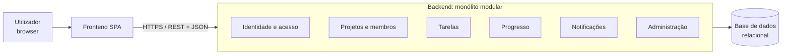

# Arquitetura — Matriz

> Ficha 02, Exercício 1. Baseado em `docs/requirements.md`, `docs/user-stories.md` e `docs/constraints.md`.
> **[P-xx]** = pressuposto; **D-xx** = decisão técnica (ver `docs/constraints.md` §4).

## 1. Fatores que pesam na decisão

| Fator | Valor | Fonte |
|-------|-------|-------|
| Escala | Até ~50 utilizadores e ~100 projetos ativos. | P-01, RNF-09 |
| Equipa | Um estudante, em contexto de aulas, com prazos curtos. | R-01, P-17 |
| Domínio | Um único domínio coeso: projetos, membros, tarefas, notificações. As regras cruzam-se muito (ex.: o responsável tem de ser membro; um projeto arquivado bloqueia as tarefas). | RF-07 a RF-18 |
| Tempo real | Não exigido. As notificações são in-app e podem ser consultadas periodicamente. | RF-16, P-21 |
| Disponibilidade | Sem requisitos de alta disponibilidade no MVP. | constraints.md §5 |
| Evolução | Funcionalidades futuras já identificadas (comentários, email, relatórios). | requirements.md §7 |

## 2. Comparação das alternativas

| Critério | Monólito | Monólito modular | Microservices |
|----------|----------|------------------|---------------|
| Complexidade de desenvolvimento | Baixa | Baixa a média | Alta (vários serviços, comunicação em rede, contratos entre serviços) |
| Deploy e operação | Uma aplicação | Uma aplicação | Vários serviços, orquestração, observabilidade distribuída |
| Consistência dos dados | Transações simples numa só base de dados | Igual ao monólito | Difícil: regras que cruzam serviços exigem coordenação (ex.: remover membro → tarefas sem responsável) |
| Organização do código | Tende a misturar responsabilidades à medida que cresce | Fronteiras claras entre módulos | Fronteiras fortes (por serviço) |
| Escala independente | Não | Não | Sim, mas não é necessária com ~50 utilizadores |
| Preparação para o futuro | Fraca | Boa: um módulo pode ser extraído para serviço se for preciso | Já está "pronto", mas paga-se o custo desde o início |
| Adequação ao MVP | Aceitável | **Boa** | Fraca: custo muito superior ao benefício |

## 3. Decisão

**Monólito modular**, com uma aplicação web (SPA) separada que consome uma API REST. ✅ Aprovado pelo Mário (D-04).

**Justificação**

1. A escala do MVP (P-01) não justifica microservices: não há partes do sistema que precisem de escalar de forma independente.
2. As regras de negócio cruzam entidades (membros ↔ tarefas ↔ notificações) e precisam de transações simples numa só base de dados.
3. Uma só aplicação para desenvolver, testar e publicar é adequada a uma equipa de uma pessoa e ao calendário das aulas.
4. Face ao monólito simples, os módulos com fronteiras explícitas mantêm o código organizado, facilitam o trabalho com agentes de IA (uma tarefa = um módulo) e permitem extrair um módulo mais tarde, se for preciso.

**Consequências aceites**

- A aplicação escala só como um todo (suficiente para RNF-09).
- É preciso disciplina para respeitar as fronteiras entre módulos: um módulo só usa outro através da sua interface pública, nunca acedendo diretamente às suas tabelas.

## 4. Componentes

| Componente | Responsabilidades | Requisitos |
|------------|-------------------|-----------|
| **Frontend (SPA)** | Ecrãs (login, projetos, lista e quadro Kanban, painel de progresso, notificações); validação básica de formulários; chama a API. Não contém regras de autorização. | RNF-07 |
| **API REST** | Ponto de entrada único; autenticação de cada pedido; tradução HTTP ↔ módulos; erros em formato uniforme. | RNF-02, RNF-06 |
| Módulo **Identidade e acesso** | Registo, login, logout, sessões, hash de passwords, bloqueio após tentativas falhadas; verificação de papéis (Membro, Gestor, Administrador). | RF-01, RNF-01, RNF-02, RNF-03, RNF-11 |
| Módulo **Projetos e membros** | Criar, editar, arquivar e reativar projetos; adicionar e remover membros; regras do Gestor. | RF-03 a RF-07, RF-18 |
| Módulo **Tarefas** | Criar, editar, eliminar e atribuir tarefas; estados; filtros; "As minhas tarefas"; marcação "Atrasada"; bloqueio de escrita em projetos arquivados. | RF-08 a RF-12, RF-15, RF-17 |
| Módulo **Progresso** | Contagens por estado e % concluída, calculadas a partir das tarefas (sem dados próprios). | RF-14 |
| Módulo **Notificações** | Recebe eventos dos outros módulos (tarefa atribuída, membro adicionado, estado alterado), cria notificações, gere lidas/não lidas. | RF-16 |
| Módulo **Administração** | Primeiro administrador na instalação; promover e despromover; registo dessas ações. | RF-02, RF-13, RF-19 |
| **Base de dados relacional** | Guarda utilizadores, projetos, membros, tarefas, notificações e registo de administração. | — |

**Regras de dependência entre módulos**

- Todos os módulos usam **Identidade e acesso** para saber quem é o utilizador e que papel tem.
- **Tarefas** usa **Projetos e membros** para confirmar que o projeto está ativo e que o responsável é membro.
- **Progresso** só lê de **Tarefas**.
- **Projetos e membros**, **Tarefas** e **Administração** publicam eventos; **Notificações** só os consome (não chama os outros módulos). Assim, acrescentar notificações por email no futuro não mexe nos outros módulos.

## 5. Decisões transversais

| Tema | Decisão | Estado |
|------|---------|--------|
| Estilo de API | REST com JSON; contrato em `openapi.yaml` (Exercício 3). | Proposto |
| Erros | Formato uniforme baseado em *Problem Details* (RFC 9457), com mensagens em português. | Proposto |
| Entrega de notificações (D-07) | O frontend consulta o contador de não lidas periodicamente (ex.: a cada 30 s) e ao mudar de ecrã. Sem WebSockets no MVP. | ✅ Decidido |
| Base de dados (D-03) | Relacional, pela natureza das relações e regras de integridade. Motor concreto por decidir. | ✅ Decidido (motor pendente) |
| Autenticação (D-05) | JWT em `Authorization: Bearer`, válido 8 h; passwords com BCrypt. | ✅ Decidido (Ficha 03) |
| Linguagem e frameworks (D-01, D-02) | Backend: Java 21 + Spring Boot 3 (Web, Security, Data JPA, Validation, Flyway). Frontend: React + Vite + TypeScript. Base de dados: PostgreSQL 16. Detalhe em `docs/implementation-plan.md` §2. | ✅ Decidido (Ficha 03) |

## 6. Pressupostos e pendentes desta fase

- A consulta periódica das notificações (30 s) é suficiente para os utilizadores [P-30, por confirmar].
- O frontend e o backend podem ser publicados no mesmo domínio, o que simplifica a autenticação [P-31, por confirmar].
- D-01, D-02, D-03 e D-05 foram fechadas na Ficha 03 (Exercício 1).
