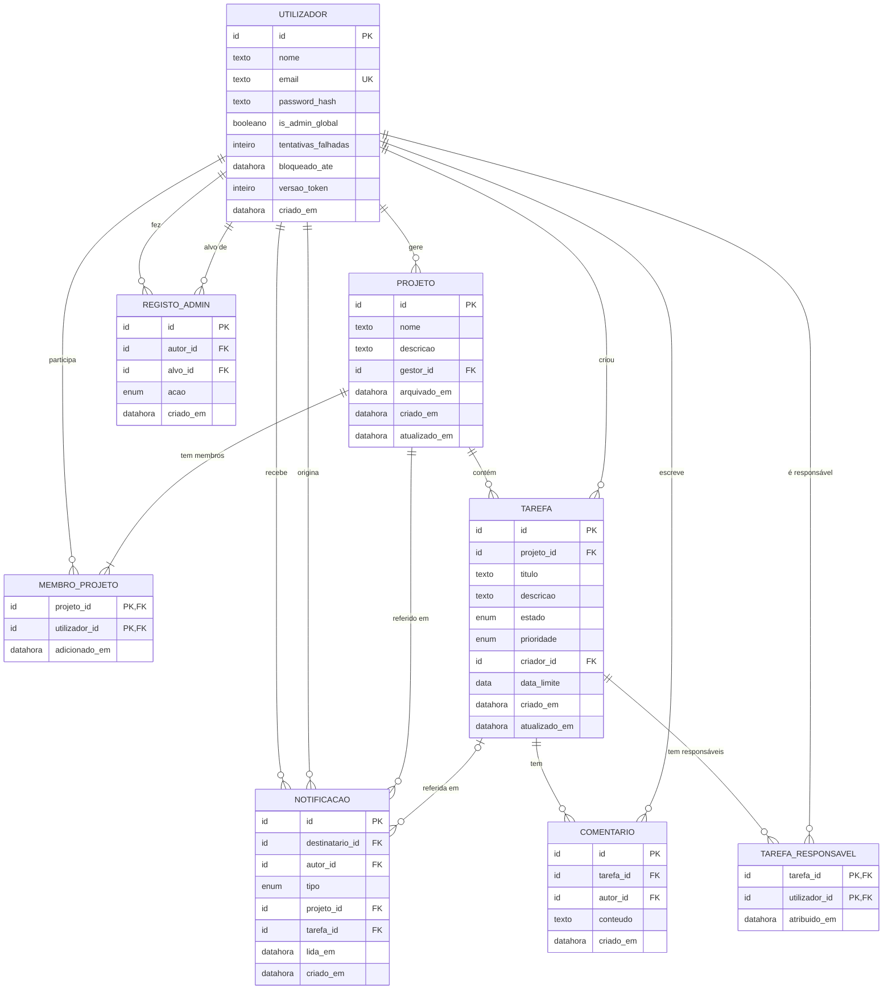

# Modelo de dados — Matriz

> Ficha 02, Exercício 2. **Atualizado na Ficha 03, Exercício 1** (vários responsáveis, comentários, eliminação de projetos, PostgreSQL); ver `docs/implementation-plan.md` §4. Modelo lógico para PostgreSQL 16 (D-03 ✅).
> **[P-xx]** = pressuposto (ver `docs/constraints.md`).

## 1. Entidades

### UTILIZADOR
Pessoa com conta na Matriz.

| Atributo | Tipo lógico | Regras |
|----------|-------------|--------|
| **id** | identificador | PK |
| nome | texto | obrigatório |
| email | texto | obrigatório, **único sem distinguir maiúsculas** (CE-08) |
| password_hash | texto | obrigatório; nunca a password em claro (RNF-01) |
| is_admin_global | booleano | por defeito `falso`; o primeiro é criado na instalação (RF-02) |
| tentativas_falhadas | inteiro | por defeito 0; repõe a 0 após login com sucesso (RNF-11) |
| bloqueado_ate | data/hora | opcional; login recusado até esta hora (RNF-11, P-29) |
| versao_token | inteiro | por defeito 0; incrementado no logout para invalidar tokens emitidos (D-05) |
| criado_em | data/hora | obrigatório |

### PROJETO

| Atributo | Tipo lógico | Regras |
|----------|-------------|--------|
| **id** | identificador | PK |
| nome | texto (≤ 100) | obrigatório, não pode ser só espaços (P-24) |
| descricao | texto (≤ 1000) | opcional (P-33) |
| gestor_id | → UTILIZADOR | obrigatório; quem criou o projeto (P-22) |
| arquivado_em | data/hora | vazio = ativo; preenchido = arquivado (RF-18) |
| criado_em, atualizado_em | data/hora | obrigatórios |

### MEMBRO_PROJETO
Associação entre utilizadores e projetos.

| Atributo | Tipo lógico | Regras |
|----------|-------------|--------|
| **projeto_id** | → PROJETO | PK (composta) |
| **utilizador_id** | → UTILIZADOR | PK (composta); um utilizador só aparece uma vez por projeto (US-04 crit. 4) |
| adicionado_em | data/hora | obrigatório |

### TAREFA

| Atributo | Tipo lógico | Regras |
|----------|-------------|--------|
| **id** | identificador | PK |
| projeto_id | → PROJETO | obrigatório; uma tarefa pertence sempre a um projeto (P-13) |
| titulo | texto (≤ 200) | obrigatório (P-24) |
| descricao | texto (≤ 2000) | opcional (P-33) |
| estado | enumerado | `POR_FAZER` (por defeito), `EM_CURSO`, `CONCLUIDA` (P-04) |
| prioridade | enumerado | `BAIXA`, `MEDIA` (por defeito), `ALTA` (P-06) |
| criador_id | → UTILIZADOR | obrigatório |
| data_limite | data | opcional |
| criado_em, atualizado_em | data/hora | obrigatórios |

"Atrasada" **não é guardada**: é calculada (`data_limite < hoje` e `estado ≠ CONCLUIDA`, P-27).

### TAREFA_RESPONSAVEL
Atribuição de responsáveis (Ficha 03: vários por tarefa, P-07).

| Atributo | Tipo lógico | Regras |
|----------|-------------|--------|
| **tarefa_id** | → TAREFA | PK (composta); apagado com a tarefa |
| **utilizador_id** | → UTILIZADOR | PK (composta); impede duplicados; tem de ser membro do projeto (RN-02) |
| atribuido_em | data/hora | obrigatório |

### COMENTARIO

| Atributo | Tipo lógico | Regras |
|----------|-------------|--------|
| **id** | identificador | PK |
| tarefa_id | → TAREFA | obrigatório; apagado com a tarefa |
| autor_id | → UTILIZADOR | obrigatório; definido pelo backend a partir do token |
| conteudo | texto (1–2000) | obrigatório, não pode ser só espaços |
| criado_em | data/hora | obrigatório; definido pelo backend |

### NOTIFICACAO

| Atributo | Tipo lógico | Regras |
|----------|-------------|--------|
| **id** | identificador | PK |
| destinatario_id | → UTILIZADOR | obrigatório |
| autor_id | → UTILIZADOR | obrigatório; nunca igual ao destinatário (P-25) |
| tipo | enumerado | `TAREFA_ATRIBUIDA`, `ADICIONADO_AO_PROJETO`, `ESTADO_ALTERADO` (P-21) |
| projeto_id | → PROJETO | obrigatório |
| tarefa_id | → TAREFA | opcional (vazio em `ADICIONADO_AO_PROJETO`); fica vazio se a tarefa for eliminada |
| lida_em | data/hora | vazio = não lida (US-14 crit. 4); não expira (P-26) |
| criado_em | data/hora | obrigatório |

O texto mostrado ("Rui atribuiu-te a tarefa T em P") é gerado a partir do tipo e das ligações; não é guardado.

### REGISTO_ADMIN
Rasto das promoções e despromoções de administradores (RF-19).

| Atributo | Tipo lógico | Regras |
|----------|-------------|--------|
| **id** | identificador | PK |
| autor_id | → UTILIZADOR | obrigatório; tem de ser administrador no momento da ação |
| alvo_id | → UTILIZADOR | obrigatório |
| acao | enumerado | `PROMOVER`, `DESPROMOVER` |
| criado_em | data/hora | obrigatório |

Os registos nunca se alteram nem se apagam.

## 2. Relacionamentos e cardinalidades

| Relação | Cardinalidade | Notas |
|---------|---------------|-------|
| UTILIZADOR **gere** PROJETO | 1 : 0..N | Cada projeto tem exatamente um Gestor. |
| UTILIZADOR **é membro de** PROJETO (via MEMBRO_PROJETO) | N : M | Um projeto tem 1..N membros (pelo menos o Gestor). |
| PROJETO **contém** TAREFA | 1 : 0..N | |
| UTILIZADOR **criou** TAREFA | 1 : 0..N | |
| UTILIZADOR **é responsável por** TAREFA (via TAREFA_RESPONSAVEL) | N : M | Uma tarefa tem 0..N responsáveis, todos membros do projeto. |
| TAREFA **tem** COMENTARIO | 1 : 0..N | |
| UTILIZADOR **escreve** COMENTARIO | 1 : 0..N | |
| UTILIZADOR **recebe** NOTIFICACAO | 1 : 0..N | |
| UTILIZADOR **origina** NOTIFICACAO | 1 : 0..N | |
| PROJETO / TAREFA **referida em** NOTIFICACAO | 1 : 0..N / 0..1 : 0..N | |
| UTILIZADOR **fez / sofreu** REGISTO_ADMIN | 1 : 0..N (cada papel) | |

## 3. Diagrama ER

## 4. Regras de negócio que o modelo sozinho não garante

Estas regras são verificadas na aplicação (módulos em `docs/architecture.md` §4), dentro de uma transação quando envolvem várias tabelas.

| ID | Regra | Origem |
|----|-------|--------|
| RN-01 | O Gestor de um projeto tem sempre uma linha em MEMBRO_PROJETO e não pode ser removido dela. | RF-07, US-05 |
| RN-02 | Cada `TAREFA_RESPONSAVEL.utilizador_id` tem de ser membro do projeto da tarefa. | RF-10 |
| RN-03 | Ao remover um membro, as suas linhas em TAREFA_RESPONSAVEL das tarefas desse projeto são apagadas (na mesma transação). | RF-07, CE-01 |
| RN-04 | Se `PROJETO.arquivado_em` estiver preenchido, não se cria nem altera nenhuma tarefa nem membro desse projeto. | RF-18, CE-05 |
| RN-05 | Tem de existir sempre pelo menos um UTILIZADOR com `is_admin_global = verdadeiro`. | RF-13, CE-03 |
| RN-06 | Cada promoção ou despromoção cria uma linha em REGISTO_ADMIN (na mesma transação). A criação do primeiro administrador na instalação não gera registo, porque não tem autor. | RF-02, RF-19 |
| RN-07 | Não se cria NOTIFICACAO quando autor e destinatário são o mesmo. | P-25 |
| RN-08 | Mover uma tarefa para o estado em que já está não altera nada nem gera notificação. | CE-10 |
| RN-09 | O email compara-se sem distinguir maiúsculas (guardar normalizado ou com índice que ignore maiúsculas). | CE-08 |
| RN-10 | Eliminar um projeto elimina membros, tarefas, atribuições e comentários; eliminar uma tarefa elimina atribuições e comentários (`ON DELETE CASCADE`, na mesma transação). | RF-21, Ficha 03 |

## 5. Decisões e pressupostos deste modelo

- **Arquivo por data em vez de booleano:** `arquivado_em` diz se está arquivado e quando. Reativar volta a pô-lo vazio.
- **Eliminar tarefa é definitivo** (sem "apagado lógico"), porque o histórico de tarefas está fora do âmbito. As notificações que apontavam para ela ficam com `tarefa_id` vazio (✅ P-32).
- **Progresso não é guardado:** é calculado com uma contagem por estado (`docs/architecture.md` §3, alternativas rejeitadas).
- **Sessões:** com JWT (D-05 ✅) não há tabela de sessões; `UTILIZADOR.versao_token` permite invalidar tokens no logout.
- **Identificadores:** `bigint` gerado pela base de dados (PostgreSQL `identity`), serializado como texto na API.
- **Índices previstos** (para RNF-08): TAREFA por (`projeto_id`, `estado`); TAREFA_RESPONSAVEL por `utilizador_id`; COMENTARIO por `tarefa_id`; NOTIFICACAO por (`destinatario_id`, `lida_em`).
