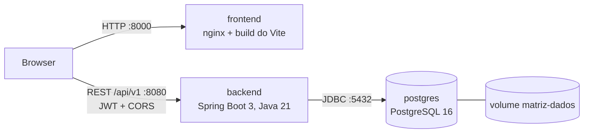

# Plano de entrega (Ficha 05)

Análise do estado da Matriz na versão 0.4.0 e plano para a preparar para entrega com Docker, Docker Compose e GitHub Actions. Ficha PL 05, Exercício 1. As decisões D1 a D11 foram apresentadas ao Mário antes de se alterar qualquer ficheiro.

## 1. Componentes

| Componente | Tecnologia | Como corre hoje (0.4.0) | Como corre depois |
|------------|------------|-------------------------|-------------------|
| `postgres` | PostgreSQL 16 (`postgres:16-alpine`) | `docker compose up -d` (único serviço) | Serviço do `compose.yaml`, com volume e healthcheck |
| `backend` | Java 21, Spring Boot 3.5.16, Maven Wrapper (Maven 3.9.11), Flyway, Spring Security (JWT HS256), Actuator | `./mvnw spring-boot:run` | Imagem `backend/Dockerfile` (multi-stage, JRE, não-root) |
| `frontend` | React 19, Vite 8, TypeScript 7, React Router 8 | `npm run dev` (Vite, porta 5173) | Imagem `frontend/Dockerfile`: build do Vite servido por nginx (não-root) |

Não há outros serviços externos: nada de email, filas, cache ou armazenamento de ficheiros. O frontend chama a API diretamente e o backend autoriza a origem por CORS (decisão da Ficha 03). Não se acrescentam componentes que o projeto não usa; o único novo é o nginx, necessário para servir os ficheiros estáticos do frontend.

## 2. Dependências, versões e comandos

| Componente | Pré-requisito | Instalar | Testar | Construir |
|------------|---------------|----------|--------|-----------|
| backend | JDK 21, Docker (Testcontainers) | `./mvnw dependency:go-offline` | `./mvnw verify` (107 testes) | `./mvnw package` |
| frontend | Node 22 (Vite 8 pede ≥ 20.19) | `npm ci` | `npm run lint`, `npm test` (32 testes) | `npm run build` |
| e2e | Node 22, Chromium do Playwright, PostgreSQL do Compose | `npm ci`, `npx playwright install chromium` | `npm test` | — |

## 3. Variáveis de ambiente

| Variável | Usada por | Segredo | Notas |
|----------|-----------|:-------:|-------|
| `POSTGRES_DB`, `POSTGRES_USER` | postgres, backend | não | `matriz` por omissão |
| `POSTGRES_PASSWORD` | postgres, backend | **sim** | Obrigatória; valor fictício no `.env.example` |
| `POSTGRES_PORTA` | postgres | não | 5433 no host (a 5432 está ocupada no Mac) |
| `MATRIZ_DB_URL` | backend | não | No Compose aponta para `postgres:5432` |
| `MATRIZ_PORTA` | backend | não | 8080 |
| `MATRIZ_JWT_SEGREDO` | backend | **sim** | Obrigatório, ≥ 32 caracteres; vazio no `.env.example` |
| `MATRIZ_CORS_ORIGENS` | backend | não | Tem de incluir o endereço do frontend |
| `MATRIZ_FUSO_HORARIO` | backend | não | `Europe/Lisbon` |
| `MATRIZ_SEED_ATIVO`, `MATRIZ_SEED_PASSWORD` | backend | demo | Contas de demonstração; desligado por omissão no backend |
| `VITE_API_URL` | frontend (build) | não | Fixado na build da imagem |

## 4. Testes automatizados existentes

- Backend: 107 testes JUnit 5 (unitários, `ArquiteturaTest`, integração com Testcontainers e PostgreSQL 16 real).
- Frontend: 32 testes Vitest + Testing Library; lint com oxlint.
- E2E: Playwright (Chromium) em `e2e/`, com base de dados própria `matriz_e2e`.

## 5. Estratégia de execução reproduzível

- Imagens multi-stage com versões fixas das imagens base, dependências fixas (`package-lock.json`, `pom.xml`) e o Maven Wrapper.
- Nenhum segredo nas imagens: tudo entra por variáveis de ambiente no arranque, a partir do `.env` (fora do Git).
- Um `compose.yaml` para os dois modos: só a base de dados para desenvolver, ou a aplicação completa.
- CI no GitHub Actions que corre os mesmos comandos em cada push e pull request, e só constrói as imagens depois dos testes.

## 6. Ficheiros a criar ou alterar

| Ex. | Ficheiro | Ação |
|-----|----------|------|
| 2 | `backend/Dockerfile`, `backend/.dockerignore` | criar |
| 2 | `frontend/Dockerfile`, `frontend/.dockerignore`, `frontend/nginx.conf` | criar |
| 3 | `docker-compose.yml` → `compose.yaml` | renomear e acrescentar `backend` e `frontend` |
| 3 | `.env.example` | acrescentar as portas e o endereço da API |
| 4 | `.github/workflows/ci.yml` | criar |
| 5 | `README.md`, `docs/architecture.md`, `CHANGELOG.md`, `docs/release-notes/v0.5.0.md` | atualizar / criar |
| 6 | `docs/delivery-validation.md` | criar (relatório) |
| fim | `openapi.yaml`, `backend/pom.xml`, `frontend/package.json`, `e2e/package.json` | versão 0.5.0 |

## 7. Etapas

1. Ex. 2: construir as duas imagens e validá-las com `docker run` numa rede com o PostgreSQL.
2. Ex. 3: `compose.yaml` com rede, volume, healthchecks e `depends_on: condition: service_healthy`; validar login, projetos e tarefas, e a persistência depois de `docker compose down` + `up`.
3. Ex. 4: CI com os jobs `backend`, `frontend`, `e2e` e, depois deles, `docker`; falha controlada e reposição.
4. Ex. 5: documentação e notas da versão candidata 0.5.0.
5. Ex. 6: seguir o README do zero, ver logs, CI e segredos; escrever o relatório; alinhar as versões e criar a tag `v0.5.0`.
